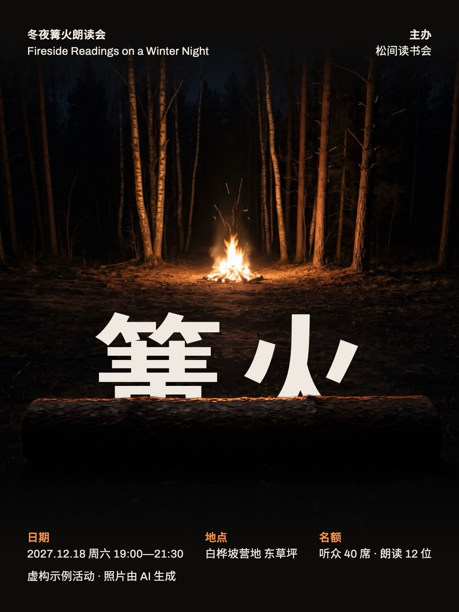

# 暗场：「冬夜篝火朗读会」海报

学这份示例的判断过程：一张靠照片撑起来的海报，怎样先把照片做对（单一光源、可抠的前景、水平的轮廓），再用一个字号、一个位置把字标压进前景；以及评审前怎样用读数而不是目测确认字标真的被压住了。不照搬构图；换了照片，轮廓高度、字标位置和下边一行的分栏都要重新定。

[可编辑源文件](dark-stage-fireside-reading/poster.html)（照片和前景图放在同一目录；字体从 Google Fonts 在线加载，离线打开会回退到系统字体，字标的压入比例会变，见文末。检查脚本导出的是 PNG，示例里存为 JPEG 预览以控制体积）

## 请求

为虚构的「冬夜篝火朗读会」做一张社媒竖版海报，和同名官网首页是一套。用户点名暗场，要求直接做、不追问；主办和地点名由制作方虚构，没有照片素材。价格、报名网址和联系方式都没给。

## Brief

- **在哪里被谁看到**：手机信息流里的 1080 × 1440 PNG，缩略约 0.25 倍，点开全屏约 0.35 倍。读者是喜欢读书、户外和冬夜活动的人。
- **阅读顺序**：先看到被倒木压住下缘的「篝火」和后面的火光；接着读到上边一行的名称「冬夜篝火朗读会」和主办；最后记住下边一行的日期、地点和名额（来听、来读各多少）。
- **逐字准确**：冬夜篝火朗读会、Fireside Readings on a Winter Night、松间读书会、2027.12.18 周六 19:00—21:30、白桦坡营地 东草坪、听众 40 席、朗读 12 位。费用没给，不上海报。
- **素材**：没有用户素材。照片和前景遮罩由制作方用生图工具生成，用插件的 `cutout.mjs` 合成前景。整件作品声明为虚构示例活动，照片注明由 AI 生成。
- **成功标准**：原尺寸和 0.25 倍缩略里「篝火」都读得出、是唯一的焦点，每个字被倒木压住 0.2–0.33；事实各出现一次，日期和地点用 `size-body`，下边一行小字底下不亮于 `edge-floor`；去色后仍认得出暗场三层和贴边小字，画面里只有一种光色。

## style.md 里起决定作用的部分

- **变体**：火是暖光，选 `ember`。整张画面只有火光一种颜色，`accent` 只用在下边一行的三个短标签上。
- **graphic 适配**：照片按画布比例（3:4）生成，光在中景，前景占画面下部、轮廓清楚；先生成照片和遮罩，用 `cutout.mjs` 合成前景，再核对轮廓图。字标一行横跨画布，按字体 Seed 的公式算出一个字号，位置按前景轮廓定。
- **上下两行**：上边一行是名称（`size-edge` 粗体，英文名下一行常规字重）和一项身份信息（主办）；下边一行 2–3 栏事实，每栏一个短标签加一行说明；虚构示例的声明排在下边一行末尾，用 `size-body`、`ink`。
- **暗角**：上下各一条渐变带，高度是画布的 16% 和 24%，靠边 40% 是实的 `paper`；不铺满画面，也不压在字标上。
- **图像 Seed**：横贯画面的前景，轮廓在字标下方大致水平，高低差不超过笔画高的约十分之一；前景是暗剪影，只有上缘被光勾亮，靠画框边的部分沉在暗里。
- **机检**：`fill`、`sink`（横贯的前景要压住每一个字）和 `backdrop`，检查脚本在导出前量出数值。

## 结构与栏位

结构原型选「主图主导」：一张照片承担整件作品，字标是照片里的一样东西，信息退到画面上下两边。

网格是 12 栏，`margin` 64，`gutter` 24。

| 次序 | 区域 | 位置与对齐 | 字级与颜色 |
| --- | --- | --- | --- |
| 1 | 照片与前景 | 满幅出血；倒木上缘在画布约 y 935（照片高度的 0.6486），火在中景正中，底部约在 46% 高 | — |
| 2 | 字标「篝火」 | 居中横跨画布，`top` 710px；落在火和倒木之间的暗地面上，下缘沉进倒木 | Noto Sans SC 700，312px，字距 0.08em；字面宽占画布 0.62 |
| 3 | 上边一行 | 左：名称和英文名；右：「主办」和「松间读书会」，齐 64 的外边距 | `size-edge` 26px，名称和标签粗体，`ink` |
| 4 | 下边一行 | 日期、地点、名额三栏按内容分列，两端对齐，每栏一行 | 标签 `accent` 粗体，说明 `ink`，都是 `size-body` 26px |
| — | 声明 | 下边一行末尾单独一行：「虚构示例活动 · 照片由 AI 生成」 | `size-body`，`ink` |

字号按字体 Seed 的公式推：两个汉字加字距的字面宽约 2.17em，`mark-fill` 0.6 乘 1080 再除以它约 300px；取 312px，让字面宽有一点余量。封顶是画布高的一半除以字高，约 800px，不起作用。

位置按轮廓定：倒木上缘在照片高度的 0.6486 处，照片按 cover 铺进画布后约在 y 935。`top` 等于这个位置减去字号的约 0.72 倍，再按检查脚本量出的压入比例逐像素微调。

## 制作

走混合路线：生成无字的照片和前景，文字全部在 HTML 的排版层，检查脚本在字体加载后导出 PNG。

- **照片**。提示词写明火是唯一的光源，不要月亮、蓝光、雪面高光和人；近处一根笔直水平、横贯画面的倒木，是暗剪影，只有上缘被火光勾出一条线，靠底边几乎全黑；画面上下是深暗的天空和地面。
- **重做一次**。第一版在审图时被退回：倒木读起来只是一条地面坡线，压字会变成一条黑带，而且左低右高，超出笔画高的约十分之一。重做时生图工具平视总把木头挡在火的正前方，火就落到了字标后面；提示词改成「站立高度、略向下看」后，木头到了近处、火退到中景，两者之间留出一段暗地面给字标。重做后字标下方那段轮廓的高低差约为笔画高的 1/34。
- **遮罩和前景**。遮罩以原图为输入生成，倒木连同上缘以下到底边涂白。`cutout.mjs` 合成透明前景，导出的轮廓图上红线贴着倒木上缘，两端沿木头端头下折。
- **共用照片**。这张 3:4 照片同时用作官网竖屏首屏的照片，海报和网页按各自的尺寸导出。

## 评审发现与修正

制作方自查后，和官网首页一起交给只拿到 Brief、style.md、检查报告和截图的空白上下文评审者，前后两轮。

| 轮次 | 发现 | 修正 |
| --- | --- | --- |
| 自查 | 字标 `top` 取 711px 时「篝」压入 0.33、「火」0.20，两个字都贴着界限 | 改为 710px：「篝」0.32、「火」0.20 |
| 自查 | 三栏等宽时，日期在 26px 下放不进一栏，会折成两行 | 三栏按内容分列、两端对齐，每条事实一行 |
| 自查 | Brief 写的是「19:00」和「费用待公布」，成品写的是完整时段、没有费用 | Brief 与成品对齐：日期写完整时段，费用没给就不上海报 |
| 1 | 海报没有实质问题 | — |
| 1 | 下边一行第三栏的标签是「名额」，而 Brief 写的是「参加方式」（和官网首页共一条） | 核对后保留「名额」：这一栏写的是两种参加方式各有多少位置，「参加」会读成怎么参加的说明；改的是 Brief 的措辞 |
| 2 | 没有实质问题 | — |

最终读数：`fill` 0.62；`sink`「篝」0.32、「火」0.20；`backdrop` 0.13 倍；8 条事实各出现一次，都是 26px，0.35 倍全屏时约 9px。

## 仍然存在的限制

- **字标压入比例两头贴着界限。** 「篝」底下是竖笔，「火」底下是斜笔，同一条水平轮廓下两字天然差约 0.12，几乎占满 0.2–0.33 的窗口，所以 `top` 只能取在中间，每移动 1px 都可能让一个字出界。
- **网页字体加载不到时，压入比例掉出下限。** 离线打开源文件会回退到系统字体，「火」的压入比例约 0.14–0.15；交付的是字体加载后导出的 PNG，不受影响。
- 倒木两端在画面以内（约 5% 和 96% 处）；字标下方那一段被完整盖住，端头只是场景的一部分。
