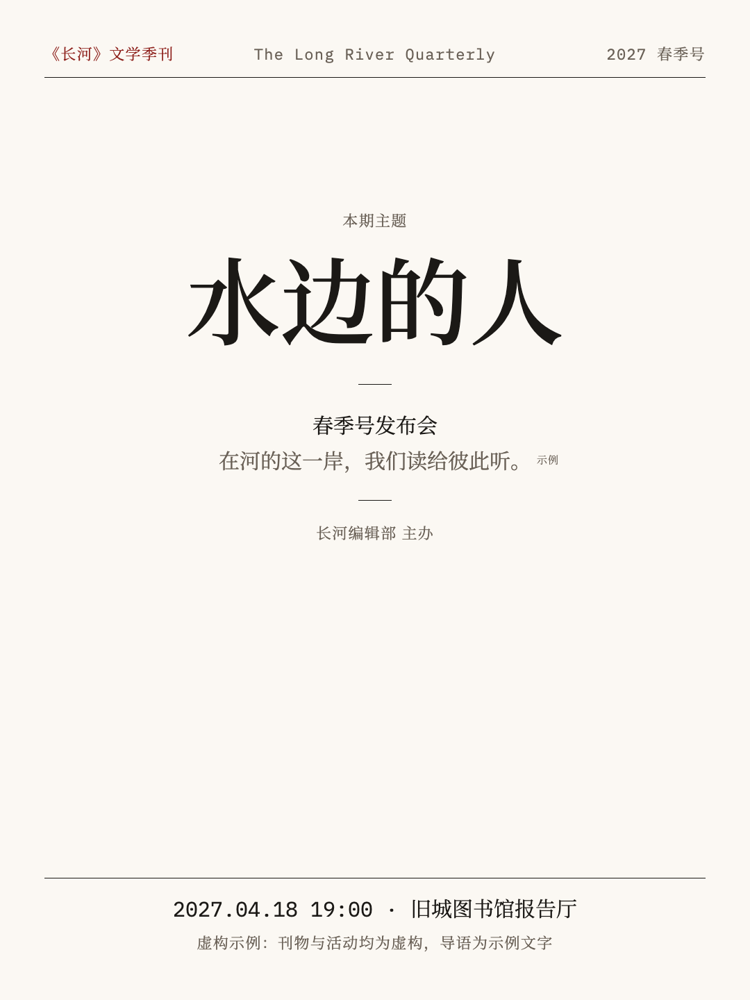

# 编辑衬线：《长河》春季号海报

学这份示例的判断过程：一张只有文字的海报，怎样靠中轴、字号阶梯和大片纸面建立层级，以及评审怎样量出「看起来居中」和「真的居中」的差别。不照搬构图；换了内容，标题组的行数、位置和页脚写什么都要重新推。

[可编辑源文件](editorial-serif-long-river/poster.html)（字体从 Google Fonts 在线加载，离线打开会回退到系统字体）

## 请求

为虚构的《长河》文学季刊春季号发布会做一张社媒竖版海报，用户点名编辑衬线，要求直接做、不追问。

## Brief

- **在哪里被谁看到**：手机信息流里的 1080 × 1440 PNG，缩略约 270px 宽。读者是季刊读者和文学爱好者。
- **阅读顺序**：先看到本期主题「水边的人」，这是唯一的焦点；接着读到这是《长河》2027 春季号的发布会；最后记住时间、地点和主办。
- **逐字准确**：《长河》文学季刊、The Long River Quarterly（保持原大小写）、2027 春季号、水边的人、2027.04.18 19:00、旧城图书馆报告厅、长河编辑部。活动名用用户原话「春季号发布会」。
- **素材**：没有照片，也没有可引用的正文，所以不留图像位、不放引文。导语一句由制作方创作，标为示例；入场方式、网址、联系方式没给，海报上不出现。
- **成功标准**：原尺寸和缩略图里「水边的人」都读得出且是唯一焦点；7 条事实各出现一次；去色后仍认得出中轴标题组、页脚版权行和组间短线，强调色只用一处。

## style.md 里起决定作用的部分

- **变体**：酒红偏文学与文化，森林绿偏自然与研究。这是文学刊物，选 burgundy；主题带自然意象，但不改变刊物本身的气质。
- **层级**：标题直接用 `size-display`，不用 `fit` 撑满栏宽；导语用 `size-title`，中文用淡墨和更大的行距；字重只用常规和半粗。
- **graphic 适配**：版面是一张扉页。顶部是书眉加通栏细线；标题组的中心落在画布高度的三分之一到一半之间，沿中轴排开「标题、短线、导语、短线、署名」；页脚是一行居中的版权信息。同一条事实不在书眉、标题组和页脚重复出现。
- **色彩**：强调色只放在编辑位置（刊名、首字、引文标记、链接），海报只用一处。
- **适用与边界**：居中只给短行，标题组里每一项不超过三行。

## 结构与栏位

结构原型选「文字主导」：没有图，一句主题就是主视觉；也没有需要并读的多组内容，所以不用编辑分区。

网格是 12 栏，`margin` 64，`gutter` 16。版心 x 64–1016，中轴 x = 540。

| 次序 | 区域 | 位置与对齐 | 字级与颜色 |
| --- | --- | --- | --- |
| 4 | 书眉 | y 64–112，`1fr auto 1fr` 三列，中项落在中轴 | 等宽 `size-body` 22；刊名用强调色（全图唯一一处），其余淡墨 |
| 1 | 标题组 | y 304–782，组中心约在画布高的 38% | 栏目「本期主题」→ 标题 `size-display` 136 墨色 → 短线 → 导语两行 `size-title` 30 → 短线 → 「长河编辑部 主办」 |
| — | 空白 | 标题组底到页脚细线，约 480px | 没有图和引文，空白就是空白 |
| 3 | 页脚 | 细线在 y = 1264 | 「日期 · 地点」等宽墨色；下面一行淡墨示例声明 |

主办已经在标题组里出现，所以页脚只写日期和地点，避免同一事实出现两次。

书眉和页脚的字号是这次推出来的：社媒图在手机上约按 0.35 倍显示，`size-meta` 15px 实际只剩约 5px，读不出时间地点，所以改用 `size-body`。

## 制作

走排版优先：固定 1080 × 1440 的 HTML，`:root` 原样接入 style.md，Playwright 在 `document.fonts.ready` 之后截图。机检不只看截图：对轴上每一行文字取文字节点的矩形，量出行中点离中轴的偏差（容差 0.02 × 画布宽），并审计计算样式里的字号、颜色和间距是否都来自 token。

## 评审发现与修正

制作方先自查一轮，再交给只拿到 Brief、style.md 和成品的空白上下文评审者，复查到没有实质问题为止。

| 发现 | 修正 |
| --- | --- |
| 中轴测量把块级元素的整行盒子算进去，量不出真实行宽（自查） | 改为只量文字节点 |
| 示例标注 15px，手机全屏时几乎读不出 | 升到 `size-body`，写明「刊物与活动均为虚构，导语为示例文字」 |
| 句末的「示例」小标挤在文字流里，把整句推偏中轴 | 小标改为绝对定位，移出文字流；句子本身居中 |
| 书眉用 `space-between`，中项偏右 22px | 改为 `1fr auto 1fr` 三列网格，中项中点正好落在 540 |
| 「春季号发布会」用淡墨，缩略图里第二读太弱 | 导语第一行是活动名，改用墨色；说明句仍用淡墨 |
| 区块起点不在 8 的倍数上 | 书眉固定高 48，标题组从 y = 304 起，页脚细线落在 y = 1264 |
| 小标贴在行框顶部，像悬空的上标；页脚底部空白比边距大 | 小标与句子同一行高、垂直居中；页脚高收到 112 |

## 这次制作推动的规则修订

「标题组在上部三分之一到一半」原本有歧义，现在写成「标题组的中心」；导语首行是活动名时可以用墨色；海报的书眉和版权行用 `size-body`，这三条都来自这件作品。

对照现行 style.md 还有两处出入：

- 版权行用了 `size-title` 30，现行规则写的是 `size-body`。版权行承载时间和地点，制作时放大了一级；照做时先用 `size-body`，在手机全屏尺寸下实测读不出再说明理由放大。
- 页脚多了一行示例声明，而规则要求页脚只有一行版权信息。这一行是为虚构示例加的；真实作品没有这一行。
