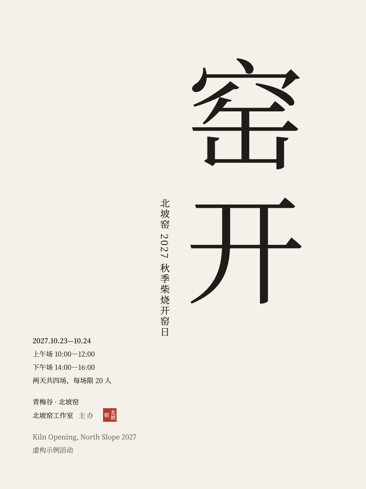

# 日式留白：「窑开」开窑日海报

学这份示例的判断过程：一张没有图的海报，怎样让两个字的竖排标题成为唯一焦点，把其余信息退到对角，并用一枚印章收住画面；评审又怎样量出「看起来对齐」和「墨迹真的对齐」的差别。不照搬构图；换了标题字数，竖排还是横排、标题放在哪条三分线上，都要重新推。

[可编辑源文件](japanese-ma-kiln-opening/poster.html)（字体从 Google Fonts 在线加载，离线打开会回退到系统字体）

## 请求

为虚构的「窑开」柴烧开窑日做一张社媒竖版海报，用户点名日式留白，要求直接做、不追问。没有照片素材，价格、报名网址和联系方式都没给。

## Brief

- **在哪里被谁看到**：手机信息流里的 1080 × 1440 PNG，缩略约 0.25 倍，点开全屏约 0.35 倍。读者是喜欢陶艺、柴烧和手作的人。
- **阅读顺序**：先看到「窑开」两个字，这是唯一的焦点；接着读到副题，知道这是北坡窑的秋季柴烧开窑日；最后记住日期、场次、地点和主办。
- **逐字准确**：窑开、北坡窑 2027 秋季柴烧开窑日、2027.10.23—10.24、上午场 10:00—12:00、下午场 14:00—16:00、两天共四场，每场限 20 人、青梅谷 · 北坡窑、北坡窑工作室、Kiln Opening, North Slope 2027。
- **素材**：没有图像，走排版优先，标题本身是焦点；没有由制作方创作的文案。没给的事实不出现在海报上。
- **成功标准**：原尺寸和 0.25 倍缩略里「窑开」都读得出且是唯一焦点；9 条事实各出现一次，日期地点用 `size-body`；去色后仍认得出偏心竖排标题、对角退场的信息组和大片有边界的纸面，朱色只用在一枚印章上。

## style.md 里起决定作用的部分

- **变体**：柴烧、窑火和手作有温度，选默认的朱色。
- **graphic 适配**：标题竖排在三分线上；整列长度约为可用高度的一半到三分之二，用 `fit --vertical` 推导；面积按墨迹的外接矩形算，标题和信息组合起来不超过画面的三分之一。没有图像时，标题本身就是焦点，不为填空加装饰。
- **信息组**：日期、地点、主办排成一组 `size-body` 的小字，放在与焦点相对的角落，朱色印章压在旁边。
- **印章**：印文必须真实、不重复标题。用户没给简称，取事实里原有的窑名「北坡窑」，三字排两列。

## 结构与栏位

结构原型选「文字主导」：没有图，两个字的活动名就是主视觉。

网格是 12 栏，`margin` 96，`gutter` 16。

| 次序 | 区域 | 位置与对齐 | 字级与颜色 |
| --- | --- | --- | --- |
| 1 | 标题「窑开」 | 竖排，左缘在第 7 栏，墨迹中线 x ≈ 725，落在右三分线上；从 y = 160 起 | `fit --vertical` 给出 294–392px，取 352px；整列墨迹占可用高度的 58% |
| 2 | 副题 | 单独竖排一列，在标题左侧，墨迹顶和「开」对齐（y = 584） | `size-title`，保留 `tracking-display`；「2027」按竖排默认方向横躺 |
| 3 | 信息组 | 左下角齐左：日期、两个场次、限额，空一级，再是地点、主办 | `size-body`，墨色；「主办」二字淡墨 |
| — | 印章 | 主办一行旁，「北坡窑」三字两列 | `seal-size`，全画面唯一的朱色 |
| — | 英文名与声明 | 信息组之后两行 | 淡墨 `size-body` |

墨迹面积合计约占画面的 23%，其余是纸面。

## 制作

走排版优先：固定 1080 × 1440 的 HTML，`:root` 原样接入 style.md，检查脚本在字体加载后导出 PNG，并留下 0.25 和 0.35 倍预览。标题、副题和印章都用 `writing-mode: vertical-rl`；单列竖排的行高只决定列宽，固定画布上取 1 没有问题（网页上要改用 `leading-display`，见同名的 web 示例）。

## 评审发现与修正

制作方自查后，交给只拿到 Brief、style.md 和成品的空白上下文评审者，复查到没有主要问题为止。两轮都没有主要问题。

| 轮次 | 发现 | 修正 |
| --- | --- | --- |
| 1 | 印章离信息组太远，看不出它标记的是主办 | 印章移到主办一行旁边 |
| 1 | 副题的墨迹顶和「开」字没对齐：按元素盒子对齐，墨迹差了几像素 | 实测「开」的墨迹顶为 582，副题起点改为 584（取 8 的倍数） |
| 1 | 检查脚本把 400 和 600 两档字重都报成同一个名字，要核实半粗是否真的生效 | 用像素量墨迹，600 比 400 多约 23%，字重确实生效 |
| 1 | 英文名用了 token 之外的字距 | 收回为 0 |
| 2 | 印章左右的空、「主办」与印章的间距只差几像素 | 判为建议，不改 |

## 这次制作推动的规则修订

- 竖排标题的长度按整列量，同一列里接在标题后的小字也算；`fit --vertical` 直接给出三分之一、一半和三分之二三档字号。
- 嵌在竖排短语里的四位年份保持默认的横躺方向，不拆成单字。
- 印内的字用 `size-meta`，印文不重复标题。

对照现行 style.md，没有发现不符之处。
