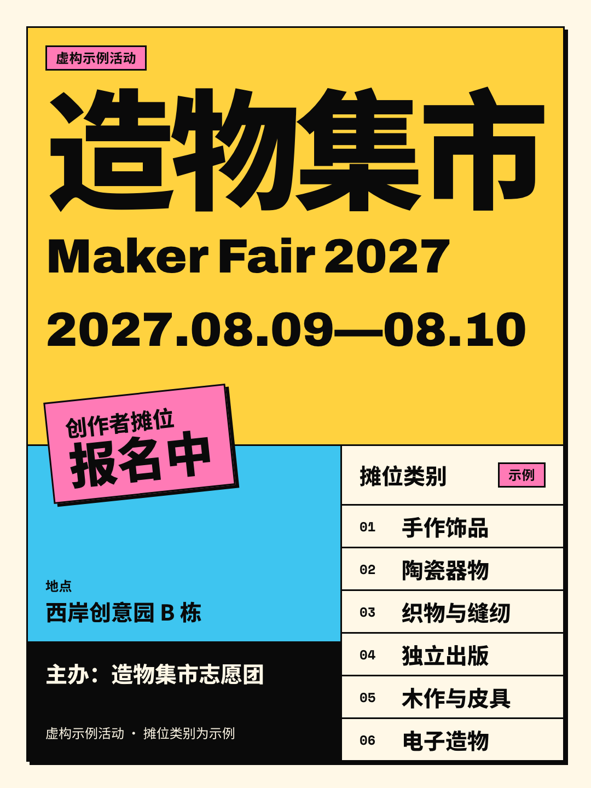

# 新粗野主义：《造物集市》海报

学这份示例的判断过程：面积比、顶满和压缝怎样决定每块板的位置。不照搬构图；换了内容，板的数量、切分和贴片位置都要重新推。

[可编辑源文件](neo-brutalism-maker-fair/poster.html)（字体从 Google Fonts 在线加载，离线打开会回退到系统字体）

## 请求

为虚构的创作者集市做一张社媒竖版海报，用户点名新粗野主义默认变体（yellow），要求直接做、不追问。

## Brief

- **在哪里被谁看到**：手机信息流里的 1080 × 1440 PNG，缩略约 270px 宽。读者是普通访客和想摆摊的创作者。
- **阅读顺序**：先看到「造物集市」和斜贴的「报名中」；接着读到 Maker Fair 2027、日期、地点；最后记住主办和 6 类摊位。
- **逐字准确**：造物集市、Maker Fair 2027、2027.08.09—08.10（破折号 U+2014）、西岸创意园 B 栋、主办：造物集市志愿团。
- **素材**：没有照片、插画和 Logo。6 个摊位类别由制作方创作，标为示例；报名截止、摊位费、联系方式都没给，海报上不出现。
- **成功标准**：缩略图里标题和「报名中」一眼可读；事实逐字正确；灰度、去阴影后仍认得出零间隙拼板墙、被标题顶满的主板和压缝贴片。

先写 Brief 再取风格。用户点名风格时，`show` 和 `resolve` 的路径很短，容易在写 Brief 之前就走完；顺序颠倒不影响这次结果，但 Brief 里的约束本该先于风格确定。

## style.md 里起决定作用的部分

- **文法三条**：零间隙拼板墙（板与板只隔一条 `rule-width` 接缝）；主板面积至少是第二大板的 `dominant-ratio`（2）倍，标题墨迹至少占主板内宽的 `fill-ratio`（0.9）；一张贴片斜压在两块板的接缝上，旋转 `sticker-tilt`。
- **graphic 适配**：主板跨满 12 栏、占墙高一半以上，放标题、副标题和日期；地点、主办排成宽窄高矮都不一样的窄板；同级条目收进一块列表板；条带可选，但不能占用贴片压住的那条接缝。
- **文字配对**：墨底板上只能放纸色字。
- **常见误用**：去掉颜色和阴影后只剩一排等大卡片。

## 结构与栏位

结构原型选「文字主导」：没有图像，标题字块就是主视觉。再从「编辑分区」借一块列表板，放 6 个同级类别。

网格是 12 栏，`margin` 48，`gutter` 16。墙的外框落在 margin 线上，接缝落在栏间隙中线。

| 次序 | 区域 | 栏位与尺寸 | 颜色 | 内容与字级 |
| --- | --- | --- | --- | --- |
| 1 | 主板 | 1–12 栏，墙高的 57% | 主色黄 | 「造物集市」由 `fit --span 12 --padding 32` 推出 237px；Maker Fair 2027 和日期用 headline 88 |
| 2 | 贴片 | 压主板与地点板之间的横缝 | 第二强调色粉，硬阴影，−6° | 「创作者摊位 / 报名中」 |
| 3 | 地点板 | 1–7 栏 | 青 | 文字贴底排，上部留给贴片 |
| 4 | 主办板 | 1–7 栏，比地点板矮 | 墨底纸色字 | 主办和示例说明 |
| 5 | 列表板 | 8–12 栏，与左侧两板同高 | 纸色 | 6 行粗线分格，等宽编号加类别名 |

需要先算清的数：主板与第二大板（列表板）的面积比为 3.17；字级 237 / 88 / 40 / 24，相邻比都不低于 `ratio-adjacent`（2）。板内边距统一取 32，让文字离接缝至少 24px。

条带没有用：它会切断贴片所在的横缝，而且缩略图里条带里的等宽小字读不出。

## 制作

走排版优先：固定 1080 × 1440 的 HTML，`:root` 逐字取 style.md，标题字号按 `fit` 的输出写死。用 Playwright 在三款字体都加载完成后截图，并用脚本量出标题墨迹宽、各板面积和贴片压住的两块板。

## 评审发现与修正

制作方先自查，再交给只拿到 Brief、style.md 和成品的空白上下文评审者，前后三轮。

| 发现 | 修正 |
| --- | --- |
| 竖缝在 6/7 栏，下半部左右等宽、两块小板几乎等高，违背「宽窄高矮不一」 | 竖缝移到 7/8 栏，左宽右窄；地点板高、主办板矮 |
| headline 用了 token 之外的 −0.02em 字距 | 去掉，回到 token |

最后一轮没有实质问题；导出的 PNG 与源文件重渲染逐像素一致。

制作时还有一项判断：线宽 token 没有随画布放大，3px 接缝在 270px 缩略图里只剩约 0.75px。实看缩略图时接缝仍可辨，所以保留 3px，没有自行加粗。

## 这次制作推动的规则修订

做这张海报时有三处规则说不清，制作方先自己定了做法，后来写进了风格：日期作为最关键的事实进主板；主板下部的空白留给贴片；板内文字离接缝至少 24px，不要求落在栏线上。对照现行 style.md，文法三条和 graphic 适配都满足。只有一处小的出入：横缝的位置按面积比推出（例如 y = 812），没有落在 8 的倍数上，而现行的间距要点要求区块起点落在 8 的倍数上。照做时把接缝取到最近的 8 的倍数即可。
