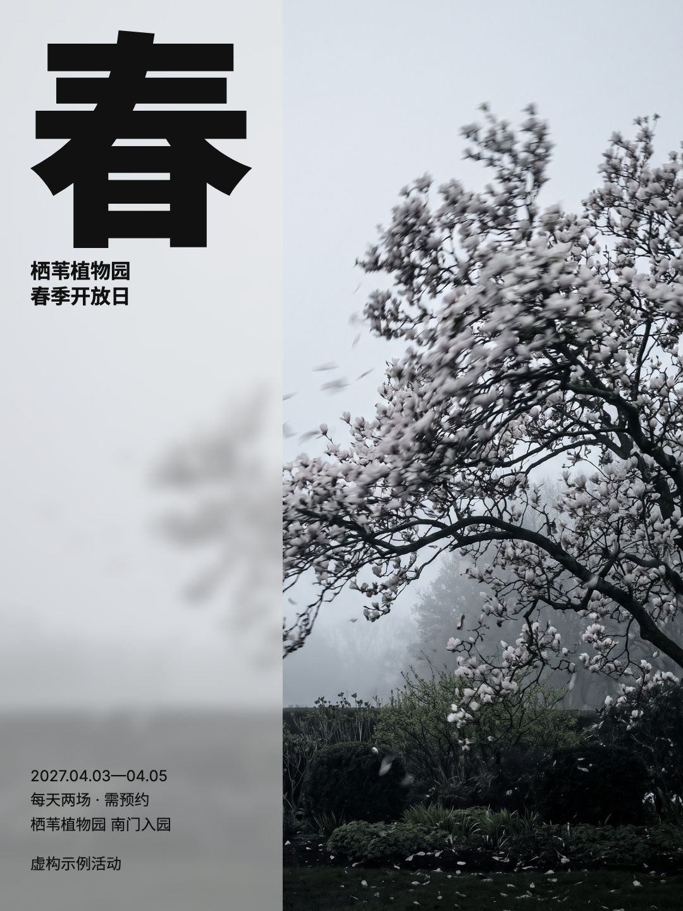

# 隔纱：栖苇植物园春季开放日海报

学这份示例的判断过程：一张照片加一块纱面的海报，怎样先在照片里找安静处和明暗边界，再定纱面的形状和巨字；评审又怎样用「把纱面换成不透明纸面」的对照图，查出纱面其实只盖着一片均匀的雾。不照搬构图：照片换了，纱面放在哪一侧、是竖条还是横带，都要重新推。

[可编辑源文件](veiled-frame-spring-garden/poster.html)：一个 HTML 加一张照片。字体从 Google Fonts 在线加载，离线打开会回退到系统字体。检查脚本导出的是 PNG，示例里存的是 JPEG 预览。

## 请求

为虚构的栖苇植物园春季开放日做一张社媒竖版海报，和同一活动的官网（见同名的 web 示例）配套。用户点名「隔纱」，变体按照片选，要求直接做、不追问。

用户给的事实：

- 日期：2027.04.03—04.05
- 场次：每天两场
- 入园：栖苇植物园 南门入园
- 主办：栖苇植物园

价格、网址和二维码都没给。

## Brief

- **在哪里被谁看到**：手机信息流里的 1080 × 1440 PNG。缩略图约 0.25 倍，点开全屏约 0.35 倍。读者是家庭和喜欢植物、拍照的人。
- **阅读顺序**：
  1. 先被照片和巨字「春」抓住。
  2. 接着读到「栖苇植物园 春季开放日」。
  3. 最后记住日期、「每天两场 · 需预约」和入园地点。
- **逐字准确**：栖苇植物园、春季开放日、2027.04.03—04.05、每天两场、栖苇植物园 南门入园。两个场次的具体时间只放在网页上，因为下组最多三行短句。
- **素材**：一张生成的照片，按画框比例 3:4 生成。和网页那组照片光线、色调一致，但不重复使用网页的图。照片里没有文字；所有字都在排版层。
- **成功标准**：
  - 0.25 倍缩略图里，「春」和照片是焦点。
  - 0.35 倍下日期和地点读得出，所以都用 `size-body`。
  - 机检的面积和倍数通过。
  - 把纱面换成不透明的 `paper` 后，画面明显变样。
  - 虚构声明放在下组末尾，用 `size-body`。

## style.md 里起决定作用的部分

- **变体**：照片的安静区是雾天，选 `bright`。下组落在深色灌木上，bright 纱面在那里显成中灰，这正是 `veil-floor` 按最坏情况校验过的。
- **graphic 适配**：
  - 先在照片里找放文字的安静处，再找它旁边的一道明暗边界。
  - 据此决定纱面是竖条、横带还是角块，让纱面跨过这道边界。
  - 纱面面积在 0.2–0.45 之间。
- **巨字**：竖条里，巨字的字面宽等于纱面内宽（纱面宽减去两侧 `veil-padding`），字号按浏览器实测的墨迹宽推。
- **两组文字**：
  - 上组是巨字，加上粗体标题，最多两行。
  - 下组是一到三行短句，可以再加一个关键数字。
  - 两组之间的空至少和巨字一样高。
- **一种墨**：纱面上的字只用 `ink`，虚构声明也一样。

## 结构与栏位

结构原型选「主图主导」：一张照片承担情绪，信息只放必需的事实。

网格是 12 栏，`margin` 64，`gutter` 24，栏宽 57.33。

| 次序 | 区域 | 位置与尺寸 | 字级 |
| --- | --- | --- | --- |
| — | 照片 | 满幅出血。右侧是风中的玉兰；开花的长枝在 35–60% 高处伸向左侧；左上是雾天；底部约 35% 是深色灌木 | — |
| — | 纱面 | 左侧竖条，第 1–5 栏，出血到上、左、下三边，宽 446.67，面积 0.41。上段压雾天，中段透出伸进来的枝条，下段跨过灌木分界 | — |
| 1 | 巨字「春」 | 从 `veil-padding` 起排，墨迹宽等于内宽 350.67 | 约 363px，`weight-display` |
| 2 | 标题 | 巨字下方隔 `space-4` | 「栖苇植物园 / 春季开放日」，`size-title` 32 粗体，两行 |
| 3 | 下组 | 钉在纱面末端，定高 184，起点在内容区 +1160（8 的倍数） | 日期、「每天两场 · 需预约」、地点三行，`size-body` 24；空一级后是声明「虚构示例活动」 |

上下两组之间空 722px。巨字墨迹高约 330px，所以「两组之间的空至少和巨字一样高」成立。

## 制作

走混合路线：照片由生图工具生成，不含任何文字；文字、纱面和网格都在一个固定 1080 × 1440 的 HTML 里。

- **生图**：提示词写明慢门拖影、近单色，安静区在哪、哪条暗边界和它相接，并排除人物、建筑、招牌和文字。照片先按 3:4 精确裁切，再缩到 1080 × 1440，没有放大。
- **纱面**：纱面是半透明的 `veil` 加 `veil-filter`，由浏览器渲染后再导出。
- **巨字**：字体加载后，用 canvas 量出墨迹宽和四边留白，再用负外边距让墨迹贴齐内距。
- **导出**：检查脚本在字体加载完成后导出 PNG，并留下灰度图和 0.25、0.35 倍预览。
- **补量的两项**：机检量面积和倍数；纱面下的亮度和「真实纱面 − 不透明纸面」的差值，由制作方的脚本另外量。

## 评审发现与修正

制作方自查后，交给只拿到 Brief、style.md、成品、检查报告和截图的空白上下文评审者（完整档），前后两轮。

| 轮次 | 发现 | 修正 |
| --- | --- | --- |
| 自查 | 第一版照片里玉兰几乎是静止的，不符合动态模糊的图像要求 | 重生成，要求慢门，让枝条和花瓣拖出影子 |
| 自查 | 下组原本有日期、上午场、下午场、地点四行事实，超过 graphic 适配的「一到三行短句」 | 场次合成一行「每天两场 · 需预约」，具体时间只放在网页上 |
| 自查 | 下组起点落在 1030.4，不在 8 的倍数上 | 给下组定高，让起点落在 8 的倍数上 |
| 1 | 纱面右缘几乎正好停在树冠左缘，树冠没有进入纱面；纱面上部约七成是平的雾，只在底部约四分之一跨过灌木分界；也没有不透明对照图，「换成 `paper` 后明显变样」无法确认 | 先出对照图，确认问题属实。纱面不能加宽（6 栏约 0.49，超过 `veil-max`），所以重生成照片，让开花的长枝在中段伸进左侧。新的对照图上，纱面中段透出枝条、底部透出灌木，与不透明纸面明显不同；两者的平均灰度差从 26.5 升到 32.2 |
| 1 | 要逐行量下组文字底色相对 `veil-floor` 的倍数和墨色对比度 | 量了，不需要改：日期 1.19 倍（墨色对比 5.52:1），「每天两场 · 需预约」1.22 倍（5.64:1），地点 1.09 倍（5.12:1），声明 1.10 倍（5.17:1），都不低于 4.5:1。换图前最低是 1.01 倍（4.83:1） |
| 1 | 关键数字「3 天」（112px）在 0.25 倍缩略图里是第二强的墨块，压过 32px 的活动名，打乱了 Brief 的阅读顺序，又和日期重复 | 去掉。巨字对标题的倍数本来就够，字体 Seed 的处理顺序不会触发；去掉它是因为 Brief 的阅读顺序，而且关键数字本来就是可选项。下组定高随之从 320 改为 184 |
| 1 | 照片 1075 × 1440，铺满画布时放大了约 0.5%；纱面右缘有一块模糊的枝梢暗斑，原尺寸下像污点 | 换图后照片正好是 1080 × 1440。那块暗斑随旧照片一起消失；新照片纱面中段的模糊块是伸进来的枝条，属于有意要的跨过边界 |
| 2 | 第二轮没有提出海报的问题 | — |

第 1 轮的第一条最值得记：机检的面积和倍数都合格，纱面在几何上也确实碰到了树冠的边，但对照图显示纱面下几乎只有雾。判断纱面有没有跨过东西，要看对照图，不能只看坐标。

## 仍然存在的限制

- **纱面读数是自测的**：纱面下的亮度和「真实纱面 − 不透明纸面」的差值，是制作方自己的脚本量的，检查脚本的机检里没有这两项。差值没有现成标准，结论以并排对照图目视为准。
- **纱面上部仍是平的**：纱面上部约四成仍是均匀的雾，那里是放巨字的安静处，按风格规则本来就该如此。纱面跨过边界的部分在中段的枝条和底部的灌木，目测合起来约占纱面的一半。
- **体积**：照片海报导出的 PNG 约 1.2 MB，比照片本身大得多，主要由照片的颗粒决定，只能靠照片的导出质量来调。
