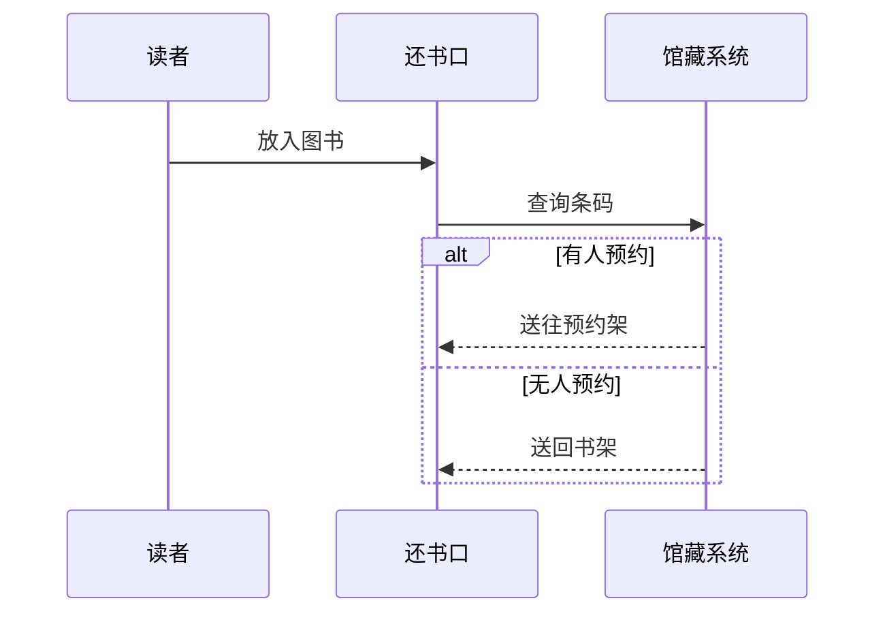
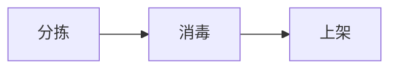

# 社区图书馆的还书流程

街角的社区图书馆去年换了一套还书系统。读者把书放进还书口，系统先扫码，再决定书去哪里。

归还的书最后都要回到书架，中间经过三个固定步骤。

以前读者要排队等馆员逐本登记；现在把书放进去就可以离开，登记在后台完成。两种方式各有取舍，读者需要同时看清。

有馆员说，新系统像一位不睡觉的门卫。真正改变的是：馆员的时间从登记转到了帮读者找书。

换系统前后四个季度的日均还书量：

| 季度 | 日均还书（本） |
| --- | --- |
| 2025 Q4 | 182 |
| 2026 Q1 | 205 |
| 2026 Q2 | 231 |
| 2026 Q3 | 248 |
