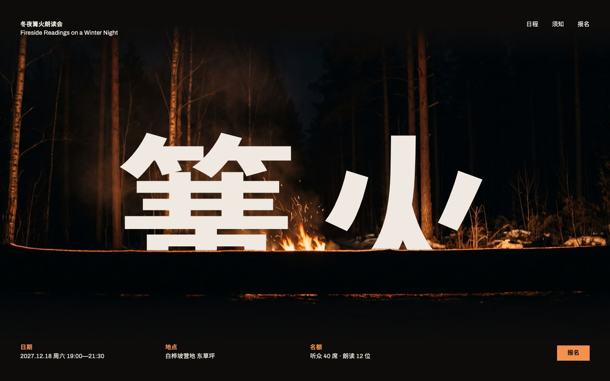

# 暗场：「冬夜篝火朗读会」官网首页

学这份示例的判断过程：一个靠照片、字标和前景三层撑起来的首屏，怎样在横屏、竖屏和各种宽高比下都让前景压住字标的下缘；首屏以下怎样退成安静的平底段落，把报名表单放进去；评审又怎样在纯键盘路径和焦点状态里找出问题。不照搬构图；换了照片，轮廓高度、字标位置和每个断点的微调都要重新量。

- [可运行的源文件](dark-stage-fireside-reading/index.html)：单个 HTML，照片和前景图放在同一目录，字体从 Google Fonts 在线加载。
- [桌面整页](dark-stage-fireside-reading/desktop-full.jpg)、[手机 375 首屏](dark-stage-fireside-reading/mobile.jpg)（检查脚本导出的截图是 PNG；这一套满幅照片，示例里改存 JPEG 以控制体积）

## 请求

为虚构的「冬夜篝火朗读会」做官网首页，单个 HTML，没有服务端。访客可以报名：来听（预约座位）或来读（报名朗读一段）。用户点名暗场，要求直接做、不追问；主办和地点名由制作方虚构。价格、报名网址和联系方式都没给。

## Brief

- **谁来、完成什么**：从社媒海报或分享链接进来的人，要看懂这是冬夜里围着篝火听人朗读、也可以自己读一段，以及日期、地点和主办；然后报名。
- **主操作与反馈**：首屏下边一行最后一栏是「报名」按钮，跳到页内表单。表单收参加方式（来听 / 来读，二选一）、称呼、到场人数（1–4，含自己）、想读的篇目（只在选「来读」时出现并必填，不超过 30 字）和电子邮箱。空提交或填错时，字段下方写一行「✕ 说明」，焦点移到第一个出错的字段，输入保留。通过后，确认文字在原位替换表单，复述所填内容，写明「这是示例页面，信息没有发送，也没有保存」，并给出「重新填写」，回到表单时输入还在。
- **状态**：参加方式未选、选中（`accent` 描边加「✓」）、聚焦（2px `accent` 描边）、出错（「✕」加文字，不只靠颜色）、完成；手机菜单展开和收起。没有异步请求，不伪造「提交中」。
- **视口与外观**：桌面 1440 × 900、平板 768 × 1024、手机 375 × 812，另看宽度扫描和几档矮屏。照片里的光是火光，只要 `ember` 一种外观，不跟随系统深浅色。
- **成功标准**：1440 与 375 下都能用鼠标和纯键盘走通「选来读 → 空提交看到出错 → 补全 → 完成 → 重新填写后输入仍在」；两个视口的首屏都读得到名称、日期、地点和「报名」，字标每个字被前景压住 0.2–0.33，贴边小字底下不亮于 `edge-floor`；页面上没有编造的价格、网址或联系方式，制作方写的段落和日程标「示例」。

## style.md 里起决定作用的部分

- **变体**：火是暖光，选 `ember`；网页不跟随系统深浅色，解析时显式传变体。
- **首屏的三层**：照片、字标、从同一张照片抠出的前景，三层用同样的 `object-fit: cover` 和 `object-position`。字标是装饰层（`aria-hidden`），名称另以真实文字放在上边一行的 `h1`。
- **字标的字号和位置**：字号写成 `min(X vw, Y svh)`，X 让字面宽达到 `mark-fill`，Y 让字标不超过画框高的约一半。位置跟着裁切走：前景轮廓在原图里的高度比例记作 s、图的宽高比记作 r，轮廓在画框里是 `50svh + (s − 0.5) · max(100vw / r, 100svh)`，字标的 `top` 等于它减去字号的一个系数，再按检查脚本量出的压入比例微调。
- **贴边小字和暗角**：上边一行是名称和导航，下边一行 2–4 栏事实加主操作；上下各一条暗角带，靠边 40% 是实的 `paper`。贴边小字只用 `ink` 和 `accent`。
- **首屏以下**：上边一行属于画框，随画框滚走；吸顶条是另一个元素，首屏滚出前隐藏。长内容和表单排在 `paper` 底的平底段落，12 栏，正文 6 栏，日程 7 栏，1100 以下单栏、最宽 40em。章节画框换一个场景或更近的镜头，不放字标。
- **竖屏**：画框比宽还高时，用 `<picture>` 按 `(max-aspect-ratio: 1/1)` 换一张竖构图的照片，并为它单独生成遮罩和前景。
- **机检**：`fill`（字面宽）、`sink`（逐字压入比例，横贯画框的前景要压住每个字）和 `backdrop`（贴边小字底下最亮的约 5% 像素），检查脚本在每个视口和宽度扫描里都量。

## 结构与栏位

页面原型组合「介绍与转化」和「完成任务」。使用顺序：首屏画框 → 日程 → 须知 → 章节画框「来读一段」→ 报名 → 页脚。没有嘉宾、篇目和往期照片，就不设这些章节。

桌面 1440 是 12 栏，`margin` 48，`gutter` 24。

| 区域 | 桌面 1440 | 平板 768 | 手机 375 |
| --- | --- | --- | --- |
| 首屏画框 | 横构图照片；字标「篝火」`min(30vw, 55.6svh)`，约 432px，字面宽 0.65 | 竖构图照片，字标约 230px | 竖构图照片，字标约 113px |
| 上边一行 | 名称（中英文各一行）和三个页内链接 | 同桌面 | 名称和「菜单」；展开为 `paper` 底、下缘 `rule` 细线的面板 |
| 下边一行 | 日期、地点、名额三栏事实，最后一栏「报名」，按 12 栏的四等分对齐 | 768–1100 按内容分列（`auto` 加 `space-between`），日期一行放下 | 两栏两行，顶对齐，按钮单独贴底 |
| 日程、须知 | 小标题 1–3 栏，正文 4–9 栏，日程 4–10 栏 | 单栏，最宽 40em | 单栏，标签列收到 4em |
| 章节画框 | 80svh，近景照片，标题和一句说明贴左下 | 同桌面 | 同桌面，照片按 60% 横向裁切露出书 |
| 报名 | 4–9 栏，两个选项并排 | 单栏，两个选项并排 | 两个选项上下排 |

字标取名称里的「篝火」两个字，加 0.08em 字距撑宽。系数 k 横图取 0.72、竖图取 0.724：两个字的字形底部不同，「篝」底下是竖笔，「火」底下是斜笔，同一条水平轮廓下两字的压入比例天然差约 0.12，所以 k 只能取在中间，让两个字都落在 0.2–0.33 之内。

## 实现

**照片**。用生图工具按画框比例生成三张照片：横构图（16:9）、竖构图（3:4）和章节近景（16:9）。提示词写明火是唯一的光源，不要月亮、蓝光和雪面高光；近处一根横贯画面、上缘水平的倒木作前景，是暗剪影，只有上缘被火光勾出一条线，靠画框底边的部分接近全黑。遮罩用同一个工具以原图为输入生成，倒木连同上缘以下到底边涂白，其余涂黑；再用插件的 `cutout.mjs` 合成透明前景，并用它导出的轮廓图核对红线贴着倒木上缘。

- 横图里火在倒木正后方，只露火苗尖，正好落在「篝」「火」两字的缝里。火要是放在中景偏右，宽高比低于 4:3 时会回到「火」字后面，暖白的字压在火心上会发虚。
- 竖图的第一版在审图时被退回：前景只是一条地面坡线加一道勾边，压字会读成一条黑带，而且左低右高，超出笔画高的约十分之一。重做时生图工具平视总把木头挡在火的正前方，提示词改成「站立高度、略向下看」才把两者拉开：近处一根认得出的带树皮倒木，中景是火，字标落在两者之间的暗地面上。重做后字标下方那段轮廓的高低差约为笔画高的 1/19（375 宽）。
- 章节近景第一版书下方多出一截来历不明的手指，评审时发现后重新生成，按原尺寸核对过两只手都接在袖子上。

**页面**。单个 HTML，`:root` 原样接入 style.md 的 token 和断点块。几处要注意的写法：

- 字标的 `top` 用上面的裁切公式，s 和 r 是 CSS 变量，`(max-aspect-ratio: 1/1)` 时换成竖图的值。两张前景都由 `` 叠在字标上，不用 CSS `mask`。
- 吸顶条是 `position: fixed` 的独立元素，用 IntersectionObserver 在首屏离开视口时显示；同时把首屏的导航、「菜单」和「报名」设为 `inert`，Tab 不会在吸顶条之后又回到滚出去的首屏。`h1` 不设，读屏仍读得到名称。
- `scroll-padding-top` 是吸顶条高加 `space-5`，点「报名」后小标题不贴着吸顶条。
- 单选卡片的焦点环平时用 `:focus-visible`，出错时改用 `:focus`：空提交后脚本把焦点移到「来听」，`.focus()` 不触发 `:focus-visible`，否则看不到焦点落在哪。
- 篇目字段只在选「来读」时出现；首次提交之后，只重查正在输入的那个字段。
- 窄屏上日期在「2027.12.18 周六」和「19:00—21:30」之间断开，两段各自 `nowrap`，`facts.txt` 用 `|` 标出这个位置。

图片合计约 2.0 MB：横图和竖图各一张 JPEG 加同尺寸的透明前景 PNG，再加一张章节照片。竖图的长边从 1920 降到 1600，否则前景 PNG 会让总量超过预算。

程序检查覆盖：三个视口和宽度扫描里的 `fill`、`sink`、`backdrop`，8 条事实逐字计数，横向溢出、遮挡和裁切，Tab 顺序与焦点可见，reduced-motion；任务路径在 1440 和 375 各走两遍：一遍用鼠标（含全空提交、来读出错、改正、完成、重新填写、改成来听再完成），一遍只用键盘（方向键选来读、篇目超过 30 字报错、Enter 提交、Space 按「重新填写」，手机上另走菜单的 Esc 和「收起」）。

## 评审发现与修正

制作方自查后，交给只拿到 Brief、style.md、检查报告和截图的空白上下文评审者，前后两轮。

| 轮次 | 发现 | 修正 |
| --- | --- | --- |
| 自查 | 竖图 k 取 0.728 时，360 宽的「火」压入 0.19；取 0.72 时，375 宽的「篝」到 0.34 | 在 320–900 的 14 个竖屏宽度上逐一量，取 0.724，全部落在范围内 |
| 自查 | 375 宽日期断在「19:00—」后面 | 日期和时段分两段各自不断行，`facts.txt` 标出断点 |
| 自查 | 手机菜单展开后用 Tab 离开，面板仍盖在首屏上 | 焦点离开面板或窗口变宽到 768 以上时自动收起 |
| 自查 | 任务路径没有走过全空提交和「来听」 | 补进任务路径：全空提交时三条「✕」说明，焦点到「来听」；改成来听后篇目字段隐藏，复述里没有篇目 |
| 1 | 空提交后焦点在「来听」卡片上，但看不到焦点环 | 出错时卡片焦点环改用 `:focus`；鼠标和键盘 Enter 两种空提交都补了截图 |
| 1 | 横构图首屏的火被「篝」盖住约一半，和竖图里完整可见的火读法不一致 | 核对后不改：量了火焰亮部在字标下露出的比例，1024–1920 各档都在 95–99%，被盖住的是火左侧的烟和火星，火苗本身在两字的缝里；字距放到 0.14em 或横移字标都没有改善。两种读法不同来自构图（横图火在木头正后方，竖图俯视），要统一只能重生横图，评审同意保留 |
| 1 | 375 的 Tab 顺序里，吸顶条链接疑似在首屏滚出之前就能聚焦 | 核对后不是缺陷：从页面顶部走 Tab，前两站是「菜单」和「报名」，吸顶条始终 `visibility: hidden`；报告里那次是在页面已滚动时走的。但滚动后确实重复，见下面一行的 `inert` |
| 1 | 768 及以下首屏下边一行日期折两行，按底对齐时三个标签高低不齐 | 改为顶对齐，按钮单独贴底；768–1100 按内容分列，日期一行放下 |
| 1 | 须知里「每位 5 分钟」这条事实和制作方写的建议共用一个「示例」 | 拆开：事实不标，建议另起一行单独标「示例」 |
| 1 | 章节照片书下方多一截来历不明的手指 | 重新生成照片，核对两只手；alt 写准「半指毛线手套」 |
| 1 | 章节说明用汉字数字；提交按钮用了 `size-body`；吸顶条高 56px 不在间距阶梯上 | 改「12 个朗读名额，每位 5 分钟」；按钮回到 `size-edge` 粗体；吸顶条高改 48px |
| 1 | 点「报名」后小标题贴着吸顶条下缘 | `scroll-padding-top` 加 `space-5`，小标题顶离吸顶条底 32px |
| 1 | `h1` 中英文名之间没有空格；完成区没有名称；必填没标出；吸顶条出现后 Tab 先过吸顶条、再过已滚出的首屏导航 | 补空格；完成区 `aria-labelledby` 指向它的标题；必填字段加 `required`（表单 `novalidate`）；首屏离开视口后它的链接和按钮设 `inert` |
| 1 | 375 的正文在「打／印稿」「防／滑的鞋」「书／名或篇名」中间断开 | 手机上标签列收到 4em，这几个词不断行 |
| 1 | 要求给出 `sink` 未取整的读数，并报告网页字体加载失败时的读数 | 只报告，见下文「仍然存在的限制」 |
| 1 | 底栏第三栏的标签是「名额」，而 Brief 写的是「参加方式」 | 核对后保留「名额」：这一栏写的是两种参加方式各有多少位置，「参加」会读成怎么参加的说明；改的是 Brief 的措辞 |
| 2 | 第 1 轮各条都已解决或确认不是问题，没有实质问题 | — |
| 2 | 交付目录里的检查截图是修改前的 | 用最终版重跑检查，覆盖原来的截图 |
| 2 | 底栏改成按内容分列后，1440 宽时「地点」不再落在第 4 栏的栏线上 | 只在 768–1100 按内容分列，1101 以上恢复四等分 |
| 2 | 卡片改用 `:focus` 后，鼠标点选也出外环 | 只在出错的字段组里用 `:focus`，其余仍是 `:focus-visible`；鼠标点选不再出外环，两张空提交截图仍有 |

第 1 轮里有三条是「核对后不改」，每条都先量过再下结论：火被盖住多少用像素比例量，Tab 顺序记下每一站所在的容器和当时吸顶条的可见性。评审只看截图和报告，看到的是某一刻的状态；补测能分清是页面的缺陷，还是截图时页面所处的状态。

## 仍然存在的限制

- **字标压入比例两头贴着界限。** 规定视口和宽度扫描里，「篝」在 0.30–0.33、「火」在 0.20–0.21。未取整的读数：1440 宽「篝」0.3227、「火」0.2029；375 宽 0.3271、0.2056；500 宽「篝」0.3310，略高于 0.33，在检查脚本 ±0.005 的容差内。原因是两个字形底部的差（约 0.12）几乎占满了 0.2–0.33 的窗口：换照片、换字号的取整，甚至换一台机器的字体渲染，都可能让一个字出界。
- **网页字体加载失败时，压入比例掉出下限。** 用系统回退字体时，「篝」约 0.25、「火」约 0.14–0.15。字标的位置是按 Noto Sans SC 量出来的，换了字形就要重量。
- **横放的手机。** 812 × 375 时画框只有 375 高，16% 的暗角带盖不住上边一行的英文名，`backdrop` 为 1.05 倍；字面宽 0.55 是高度封顶，风格允许。这不在 Brief 的视口里。
- **没有在真机上验证。** `svh` 在移动浏览器地址栏伸缩时的表现、竖图前景与照片的对齐，都只在桌面浏览器的模拟视口里看过。
- 竖图的倒木两端在画框以内，768 × 1024 和更宽的竖屏上看得到端头；端头外不算前景，字标也不到那里。
