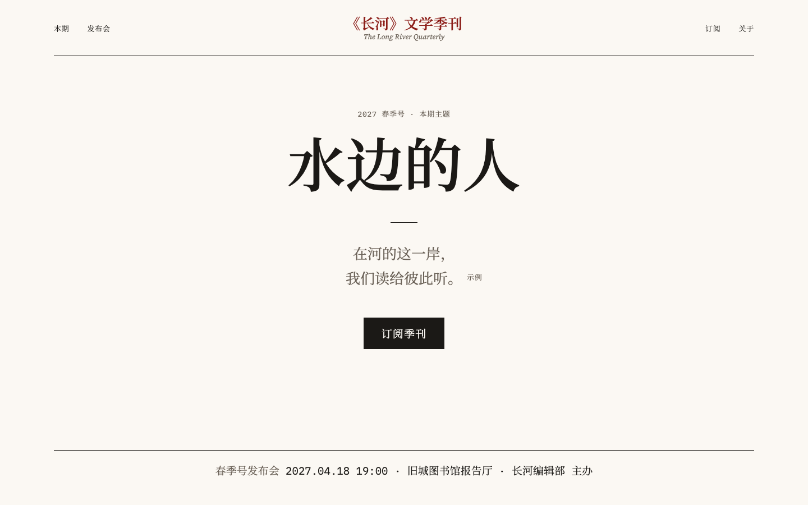

# 编辑衬线：《长河》季刊官网首页

学这份示例的判断过程：一个安静的居中版式，怎样把强调色、状态和示例标注都放进有限的「编辑位置」；评审又怎样发现一条看似合理的修改引入了回归。不照搬构图；换了内容，章节、正文栏宽和表单字段都要重新推。

- [可运行的源文件](editorial-serif-long-river/index.html)：单个 HTML，字体从 Google Fonts 在线加载。
- [桌面整页](editorial-serif-long-river/desktop-full.png)、[手机 375 首屏](editorial-serif-long-river/mobile.png)

## 请求

为虚构的《长河》文学季刊做官网首页，单个 HTML，没有服务端。用户点名编辑衬线，要求直接做、不追问。

## Brief

- **谁来、完成什么**：季刊读者多从社媒海报或分享链接进入，要看懂刊名、2027 春季号、本期主题「水边的人」，以及发布会的时间、地点和主办；要完成的是订阅季刊。
- **主操作与反馈**：首屏一个「订阅季刊」按钮，跳到页内表单。用户没给价格、付款和寄送方式，所以只收称呼和电子邮箱，只登记订阅意向。出错时字段下写一行说明，保留输入，焦点移到第一个出错字段；通过后用居中的确认文字替换表单，如实说明信息没有发送也没有保存，并给出重新填写的入口。
- **状态**：没有异步请求，不伪造「提交中」；空表单提交即出错；聚焦、出错、完成各有形态。
- **视口**：桌面 1440 × 900、手机 375 × 812，另查 1100px 断点。
- **成功标准**：两个视口的首屏都读得到刊名、期号、主题和发布会时间地点，且只有一个主操作；订阅路径用键盘走通；每段由制作方写的文字旁有可见的「示例」标注，页面上没有编造的价格、网址或联系方式。

## style.md 里起决定作用的部分

- **层级**：标题直接用 `size-display`，不用 `fit`；导语用 `size-title`，中文用淡墨和更大的行距。
- **色彩**：强调色只放在编辑位置（刊名或栏目名、首字、引文标记、链接、当前态、出错说明），网页每屏按视口高度计最多两处。
- **web 适配**：首屏是一张扉页，书眉、中轴标题组和底部一行版权行；正文栏 6 栏居中，旁注在外侧窄栏；1100px 以下正文栏放宽到 8 栏，旁注移到段落之前；窄屏 4 栏，正文字号不小于 18px 优先于每行字数。
- **状态**：输入框只有底线；聚焦时整个输入框加墨色描边框；出错时底线加粗并写一行强调色说明；完成后居中的斜体确认文字替换表单。
- **不为凑版式编内容**：没有篇目、嘉宾和引文，就不设这些章节。

## 结构与栏位

页面原型组合「介绍与转化」和「完成任务」。使用顺序：书眉导航 → 首屏扉页（主题、唯一主操作、版权行里的时间地点）→ 本期主题 → 发布会 → 订阅 → 页脚。

桌面 1440 是 12 栏，`margin` 96，`gutter` 32，中轴 x = 720。

| 区域 | 桌面栏位与对齐 | 手机 375 |
| --- | --- | --- |
| 书眉导航 | 刊名在中轴，用强调色；链接分在两侧 | 刊名居中，链接排成下方一行 |
| 首屏标题组 | 中轴：栏目行 → 「水边的人」`size-display` → 短线 → 两行导语 → 「订阅季刊」 | 中轴，标题按 mobile 断点缩小 |
| 首屏版权行 | 首屏底部，上方一条版心宽细线 | 三条事实各占一行 |
| 本期主题 | 正文 4–9 栏齐左，旁注 10–11 栏 | 正文跨满，旁注在正文之前 |
| 发布会 | 4–9 栏，细线分隔的行：左 2 栏标签、右 4 栏值 | 标签在上、值在下 |
| 订阅 | 4–9 栏，表单齐左；完成态居中 | 跨满 |

强调色要提前算预算：首屏只有刊名一处；订阅屏两个字段同时出错时已经用满两处，所以这一屏不再放强调色链接，完成态的「重新填写」链接要等出错说明消失后才出现。

## 实现

单个 HTML，接入 style.md 的 `:root` 和断点块，加载三款字体。首屏用 `min-height: 100svh` 让版权行落在首屏底部。程序检查覆盖：轴上每一行文字的中点偏差、计算样式里的字号、颜色和间距是否来自 token、7 条事实逐字计数、强调色的数量和位置、横向溢出、Tab 顺序和每个焦点的描边。

## 评审发现与修正

制作方先自查一轮，再交给只拿到 Brief、style.md 和成品的空白上下文评审者，续用同一个评审者复查到没有实质问题为止。

| 轮次 | 发现 | 修正 |
| --- | --- | --- |
| 自查 | flex 列里的 `margin: 0 auto` 让版心收缩到内容宽，书眉细线没有跨满版心 | 版心显式设为满宽 |
| 自查 | 完成态容器被 `focus()` 后画出方框，看起来像一张卡片 | 只为读屏接收焦点的确认区不画焦点框 |
| 1 | 订阅说明句是示例内容，却没有「示例」标注 | 补上标注 |
| 1 | 完成态首句「订阅已在本页登记」与后文「没有发送，也没有保存」矛盾 | 改为如实的措辞 |
| 1 | 聚焦用外框，与 Brief 写的「底线加粗」不一致 | 聚焦改为底线加粗 |
| 1 | 标题 `nowrap`，换成更长的主题会撑破页面 | 改为 `text-wrap: balance` |
| 2 | 上一轮的改法引入回归：出错字段本来就是加粗底线，聚焦时再加粗底线看不出焦点 | 聚焦改为整框墨色描边，出错仍是底线加文字，两种形态分开 |
| 3 | 窄范围复查：出错字段的焦点、小标对齐和断行都没有实质问题 | — |

第 2 轮的发现说明评审建议也要复查：照第 1 轮建议改完后，必须把受影响的状态组合（这里是「出错且聚焦」）重新截图。收尾时制作方又看到 375 宽下「《长河》／文学季刊」被断开，`innerText` 计数发现不了断行，所以给正文里的事实串加了 `nowrap`。

## 这次制作推动的规则修订

聚焦与出错用不同的形态、强调色每屏按视口高度计数、1100px 以下旁注移到段落之前、窄屏正文字号优先于每行字数、版权行在手机上可以按事实断行，这几条现行规则都来自这件作品的摩擦和评审。对照现行 style.md，没有发现不符之处。
