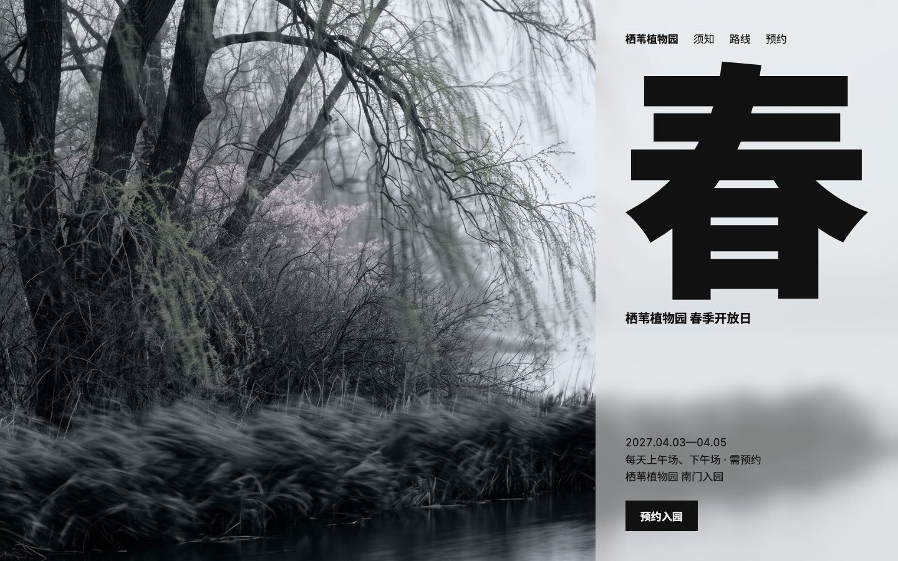

# 隔纱：栖苇植物园春季开放日官网首页

学这份示例的判断过程：一个靠照片和一块纱面组织的页面，怎样为每个画框挑照片，让纱面跨过照片里的明暗边界，而不是盖在一片均匀的雾上；竖条、横带和角块怎样在桌面、横屏平板、竖屏和手机之间切换；评审又怎样查出宽矮屏、横屏手机和读屏这些截图里看不出的问题。不照搬构图；照片换了，安静区和边界的位置就变了，纱面放在哪、在哪个断点换形状，都要重新推。

- [可运行的源文件](veiled-frame-spring-garden/index.html)：单个 HTML 加 6 张照片，照片用相对路径引用；字体从 Google Fonts 在线加载。
- [桌面整页](veiled-frame-spring-garden/desktop-full.jpg)、[手机 375 首屏](veiled-frame-spring-garden/mobile.jpg)。截图存成 JPEG 以控制体积；检查脚本导出的是 PNG。

## 请求

为虚构的栖苇植物园做春季开放日官网首页，单个 HTML，没有服务端。主任务是预约一个入园场次：选日期和场次，留称呼、人数和邮箱。用户点名「隔纱」，变体按照片选；要求直接做，不追问。

用户给的事实：
- 日期：2027.04.03—04.05。
- 场次：每天两场，上午场 09:00—12:00，下午场 13:30—16:30。
- 限额：每场限 300 人，每次预约最多 6 人。
- 地点：栖苇植物园 南门入园。主办：栖苇植物园。
- 英文名：Qiwei Botanical Garden · Spring Open Days 2027。

门票、网址、电话、地址和交通都没给。

## Brief

- **谁来、完成什么**：从社媒海报或分享链接进来的访客，手机为主。要看懂这是栖苇植物园的春季开放日、在哪三天、从哪入园，然后预约一个场次。
- **主操作与反馈**：
  - 首屏一个「预约入园」按钮，跳到页内表单。
  - 表单收：场次（六选一的 radio 组）、称呼、人数（1–6）、电子邮箱。
  - 空提交或填错时，字段下写一行墨色说明，前面加「✕」；焦点移到第一个出错的字段，输入保留；改对的字段说明随即消失。
  - 通过后，确认文字在原位替换表单，回显所填内容，并如实说明信息没有发送、也没有保存；另有「重新填写」，回去后输入都还在。
- **状态**：
  - 未选和选中：选中项是墨底 `paper` 字，加「✓」。
  - 聚焦：2px 墨色描边。
  - 出错：「✕」加文字。
  - 完成。
  - 手机菜单的展开和收起。
  - 没有异步请求，所以不伪造「提交中」。
- **视口**：1440 × 900、768 × 1024、375 × 812，以及检查脚本扫描的宽度和矮屏。页面不跟随系统深浅色，Template 明确要求只用一个变体。
- **成功标准**：
  - 1440 用鼠标、375 只用键盘，都走通「预约入园 → 空提交 → 出错 → 补全 → 完成 → 重新填写后输入仍在」。
  - 两个宽度的首屏都读得到活动名、日期、地点和主操作。
  - 页面上没有编造的价格、网址、联系方式；由制作方写的段落都标「示例」。
  - 每个画框的纱面换成不透明的 `paper` 后，画面明显变样。

## style.md 里起决定作用的部分

- **变体按照片选**：六张照片的安静区都是亮的（雾天、湖面、温室喷雾、雾中草地），所以选 `bright`。暗部（芦苇、叶丛、树篱）都落在纱面跨过的那一侧，bright 纱面压在上面显成中灰，正是 `veil-floor` 校验过的最坏情况。
- **纱面跨过一道明暗边界**：纱面盖住安静处，并跨过旁边一道边界，跨过的部分约占三分之一；判断标准是「换成不透明 `paper` 后作品明显变样」。这一条决定了照片怎么生成：每张照片的提示词都写明安静区在哪、哪条暗边界和它相接。
- **巨字**：
  - 竖条和角块里，巨字的字面宽等于纱面内宽。实现上，字体加载后用 canvas 量出墨迹宽和四边留白，写成 CSS 变量，字号写成 `calc(100cqw / 墨迹宽)`，再用负外边距让墨迹贴齐内距。
  - 横带里，巨字按画框高推：`min(size-display, 画框高 × veil-max − 2 × veil-padding − 上组其余行高)`。
  - 巨字至少是标题的 6 倍；有关键数字时，至少是它的 2 倍。
- **web 适配**：
  - 首屏导航放在纱面上组的第一行。
  - 滚出首屏后出现 `paper` 底的吸顶条，下缘一条 `rule` 细线。
  - 章节画框的纱面不贴画框上边，每章的纱面形状或位置都和上一章不同。
  - 手机上每个画框的巨字都只用一个字，完整的词写进标题行。
  - 主操作是墨底直角按钮，每个画框最多一个。
- **机检**：给元素标上 `frame`、`veil`、`glyph`、`title`、`figure`，检查脚本就量面积（0.2–0.45）和两条倍数。纱面下的亮度是否不低于 `veil-floor`、换成不透明纸面后差多少，不在机检里，由制作方自己量（见「仍然存在的限制」）。

## 结构与栏位

页面原型组合「介绍与转化」和「完成任务」。使用顺序：首屏画框 → 开放日须知 →「径」章画框 → 看花路线 →「约」章画框 → 预约表单 → 页脚。章节只按已有内容设置：没有嘉宾和价格，就不设这些区块。

桌面 1440 是 12 栏，`margin` 64，`gutter` 24。

| 区域 | 桌面 1440 | 平板 768 | 手机 375 |
| --- | --- | --- | --- |
| 首屏（湖岸柳丛） | 右侧竖条，第 9–12 栏，出血到上、右、下三边；上段压雾天，下段跨过芦苇带。巨字「春」403px，面积 0.34 | 贴顶横带，换竖图，`min-height: 44%`，下部约三分之一跨进柳丛；巨字 200px | 同平板，巨字 128px，导航收成「菜单」 |
| 开放日须知 | 标题第 1–3 栏，正文第 4–9 栏；事实表用细线分行，门票和交通写「待公布」 | 标题跨满，正文第 1–9 栏 | 4 栏跨满 |
| 「径」章（温室） | 悬在中段的横带（top 32%），巨字「径」和「三条看花路线」在左，两行短句在右；下缘压进叶丛。巨字 228px，面积 0.44 | 同，竖图，top 30% | 同，巨字 128px |
| 看花路线 | 第 4–9 栏，三条用细线分开，整组标一次「以上路线为示例」 | 第 1–9 栏 | 跨满 |
| 「约」章（樱花与高篱） | 左下角块，第 1–5 栏，上边定在 22%（雾天和高篱的分界），高篱从角块中段横穿。巨字「预约」，标题「每场限 300 人」，关键数字「6 场」 | 贴底横带，巨字「约」，标题「预约入园 · 每场限 300 人」 | 同平板，标题在「·」后断行 |
| 预约表单 | 第 4–9 栏；场次是 3 天 × 2 场的格子 | 第 1–9 栏 | 场次两列 |

- 900–1100 宽的横屏，首屏仍用竖条，只是加宽到第 8–12 栏，好让上组的导航行放得下；<900 或竖屏才改横带。
- 平底段正文 `max-width: 40em`，每行不超过 40 个汉字。

style.md 之外的值（交付时写明）：
- 吸顶条高取 `space-7`，`scroll-padding-top` 是它加 `space-4`。
- 菜单按钮高 44px。
- 章节画框高：桌面 90svh、手机 80svh。
- 高 ≤560 的横屏，画框改为固定的 720px（首屏）和 648px（章节）。
- 320–359px 宽，巨字降到 112px。
- 「约」角块上边定在 22%。
- 首屏竖条和「约」角块的巨字另有高度上限。

## 实现

单个 HTML，接入 style.md 的 `:root` 和断点块。照片由生图工具按画框比例生成（宽图 16:9，竖图 9:16），导出时长边分别为 1920 和 1600，JPEG 质量 80。同一个画框按断点用 `<picture>` 换宽图或竖图，alt 对两张都成立。几处容易出错的写法：

- **巨字**：巨字按墨迹对齐后，行框会伸出纱面内距，盖住上一行的控件，所以要加 `pointer-events: none`。只按宽度推的字号在宽矮屏上会撑破画框，所以首屏竖条和「约」角块的巨字都另加了高度上限。
- **横屏手机**：svh 公式会把横带里的巨字算成 0。高度 ≤560 的横屏，画框改用固定高度。
- **场次单选**：radio 的可访问名称要带上日期。出错状态写在每个 radio 上，不写在 fieldset 上。由脚本移过去的焦点，要用 `:focus` 画出来，不能只靠 `:focus-visible`。

程序检查覆盖：
- 默认三个视口、宽度扫描和矮屏的溢出、遮挡、裁切；
- 10 条事实逐字计数；
- 两条倍数和面积；
- 1440 用鼠标、375 只用键盘走完的预约路径；
- 1536×730、1920×800、1920×720、2560×1080、812×375 的补测。

纱面下的亮度和「真实纱面 − 不透明纸面」的差值，由制作方的脚本在 11 个视口上量，并出了并排对照图。

## 评审发现与修正

制作方自查后，交给只拿到 Brief、style.md、成品、检查报告和截图的空白上下文评审者（完整档），前后两轮。

| 轮次 | 发现 | 修正 |
| --- | --- | --- |
| 自查（照片） | 手机首屏的竖图天空占了上半，贴顶横带只压在天空上，和不透明纸面的平均灰度差只有 4，读成实心面板 | 重生成竖图，让柳丛边界升到约 30% 高，并裁掉顶部 6% 天空；差值升到 19 |
| 自查（照片） | 「约」章第一版宽图的矮篱从画面 25% 处才开始，左端还淡进雾里，左下角块下面几乎是均匀的雾 | 重生成，要求高篱横贯全宽 |
| 自查（照片） | 温室宽图的叶子几乎是静物，不符合动态模糊的图像要求 | 重生成，叶子吹出拖影 |
| 自查 | 1024 × 768 横屏的首屏横带压在柳冠上，柳冠是画面里在动的主体 | 900–1100 横屏保留竖条，加宽一栏 |
| 自查 | 手机「菜单」按钮点不动：巨字的行框盖住了它。检查脚本没有报，是任务路径点击超时才发现的 | 巨字加 `pointer-events: none` |
| 自查 | 鼠标提交后，焦点移到场次却看不到描边；菜单打开后 Tab 出去，面板仍盖着焦点所在的控件 | 场次格改用 `:focus`；焦点离开面板时收起 |
| 自查 | 首屏巨字只按宽度推，算下来 1920 × 800 时上下两组共需约 881px，超出画框；横屏手机上巨字被算成 0–15px，面积 0.67–0.9；正文在 1100 宽（跨 9 栏）和 1680 以上会超过每行 40 字（按栏宽推算） | 首屏巨字加高度上限；高度 ≤560 的横屏固定画框高；正文 `max-width: 40em` |
| 1 | 「约」角块在宽矮屏上贴到画框上边，上下组之间没有留空，宽屏上长成贴上下边的竖条 | 上边定在 22% 的明暗分界，巨字加高度上限，高度 ≤760 时去掉「6 场」。在 8 个桌面尺寸上量：纱面离画框上边 139–214px，上下组相隔 48–75px，巨字都在纱面内，面积 0.32 |
| 1 | 六个场次 radio 的可访问名称不含日期，只有两种名字；`aria-invalid` 写在 fieldset 上 | 选项里加视觉隐藏日期；`aria-invalid` 和 `aria-describedby` 写在每个 radio 上。可访问性树里六个名称各不相同 |
| 1 | 手机「菜单」也是墨底按钮，和主操作抢焦点 | 改为 1px 墨色描边的常规字按钮，仍高 44px |
| 1 | 表单标签和出错说明用了粗体，字体 Seed 要求常规体 | 改为 `weight-text` |
| 1 | 邮箱格式出错、改对后说明消失、首屏按钮到达表单，这三个状态没有截图 | 任务路径在 1440 和 375 都补拍 |
| 1 | 「约」画框里「6 场」紧挨着「每次预约最多 6 人」；桌面巨字「预约」和标题「预约入园」重复 | 删掉画框里「最多 6 人」那一行。桌面巨字仍用「预约」（理由见下），标题改为「每场限 300 人」 |
| 1 | 自动定位后，内容紧贴吸顶条 | `scroll-padding-top` 加 `space-4` |
| 1 | 完成标题「这次预约只记在了本页」可能读成预约成功 | 改为「信息已填好，还没有发送」 |
| 1 | 768 宽路线正文有单字孤行 | 加 `text-wrap: pretty` |
| 1 | 812 × 375 的纱面对照图前后条件不一致 | 两张都隐藏吸顶条，截完整画框重新对照 |
| 1 | 风格之外的值要能写进交付说明；「✕」会被读成「乘号」 | 吸顶条高和输入框高改回 token，其余值列在上文；「✕」包进 `aria-hidden` |
| 2 | 复查结论：第一轮的问题已解决（复查报告写的是 14 条，网页和海报合计），没有实质问题；交付前要改下面两处 | — |
| 2 | ≤1100 时「约」画框只剩单字巨字，可见标题里没有完整的「预约入园」 | ≤1100 标题显示「预约入园 · 每场限 300 人」，手机上去掉下组里重复的那一行 |
| 2 | `.opt:hover span` 会命中新加的视觉隐藏日期 | 改成 `.opt:hover > span` |

第 2 轮提出的两处，是在复查之后改的：只重跑了检查脚本（findings: none），并由制作方目视了 768、812 × 375 和 375 的「约」画框，没有再请评审复查。

**桌面「约」章为什么仍用两字巨字**：角块宽 5 栏，内宽约 500px。一个「约」字按内宽推出约 540px，角块装不下下组；把角块改窄到 3 栏，面积又只剩 0.20，正好压在下限上。所以桌面用两字词「预约」（Template 允许两三个字的极短词），手机按 Template 只用一个字。

这一轮最该记住的是照片。三张照片是在桩页阶段换掉的：先只搭画框、照片、纱面和真实行数的文字，量面积，再把纱面换成不透明纸面对照，确认纱面确实跨过了东西，再写页面。

## 仍然存在的限制

- **宽矮屏**：巨字受高度上限，比纱面内宽窄，纱面右侧留白。例如 1920 × 800 下，「约」章墨迹约 380px，内宽约 700px。
- **矮屏不显示关键数字**：桌面宽度 ≥1101、高度 ≤760 时，「约」章不显示「6 场」。这条按高度触发，与宽度无关。
- **横屏手机**：
  - 812 × 375 下，首屏贴顶横带压在模糊的柳冠上。对比度达标（1.25 倍 `veil-floor`，墨色对比 5.74:1），但证据只有这一档。
  - 这档画框比视口高，要滚动才能看全。
- **自测数据**：
  - 纱面下文字区的亮度在 11 个视口都不低于 `veil-floor`，最低 1.05 倍。
  - 真实纱面和不透明纸面的平均灰度差在 15.6–64.3 之间，最低的一处是 900 × 900 首屏。
  - 这些都是制作方自己的脚本量的，检查脚本的机检里没有这两项。
- **没有验证的项**：
  - 没有用读屏软件实测，只看了可访问性树。
  - `prefers-reduced-transparency`，以及不支持 `backdrop-filter` 时纱面退为不透明 `paper` 的回退，没有截图。
  - 吸顶条没有「当前章节」状态。
